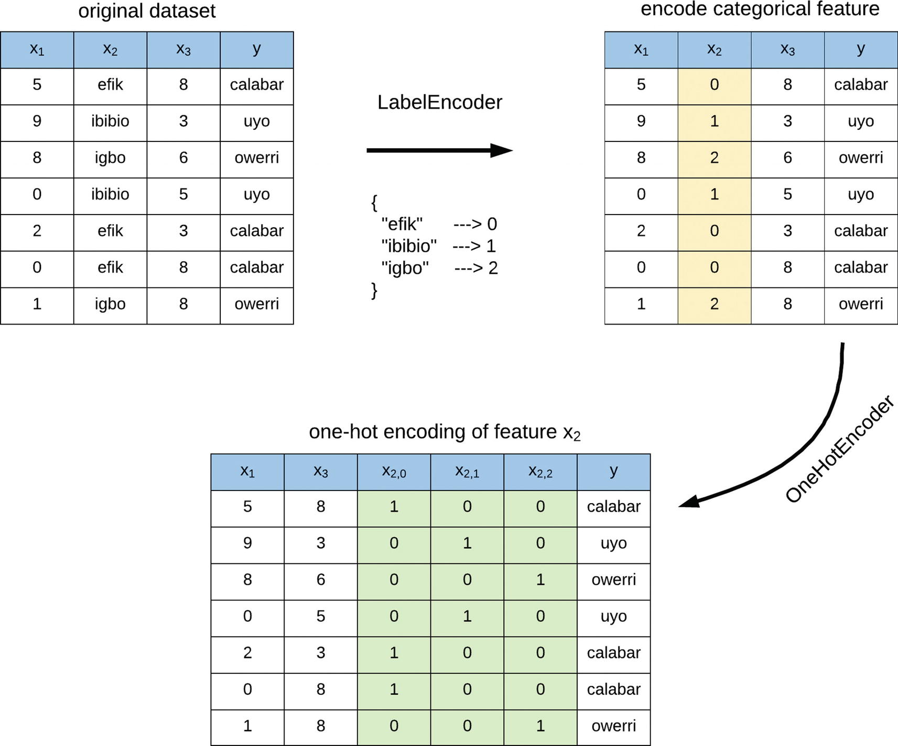

# Lab 05 - Czyszczenie danych

Celem czyszczenia danych jest:
- wykrycie elementów brakujących i ich uzupełnienie lub usunięcie wierszy
- konwersja danych (np daty) i typów nominalnych (w tym korekta błędów w nazwach elementów, np. poznań, Poznan, Pznan, Poznań)
- analiza rozkładów i usunięcie elementów odstających (outlierów) (Lab 06)
- normalizacja danych i normalizacja rozkładu (Lab 06)

### Zbiór danych

W zadaniach będziemy posługiwać się zbiorem opisującym historię sprzedaży budynków, zawierającym szczegóły dotyczące nieruchomości oraz cenę za jaką zostały sprzedane: [melb_data.csv](./_resources/lab_05/melb_data.csv).

Potrzebne biblioteki: `pandas`, `scikit-learn`, `rapidfuzz` (`pip install pandas scikit-learn rapidfuzz`).

### Ocena efektów - skuteczność predykcji ceny (regresja)

W zadaniach spróbuj odnieść efekty wprowadzonych zmian do jakości predykcji ceny nieruchomości. Przewidujemy wartość ciągłą (`Price`), jest to więc zadanie **regresji**, a nie klasyfikacji. Do oceny zastosuj funkcję:

```python
from sklearn.ensemble import RandomForestRegressor
from sklearn.metrics import mean_absolute_error


def score_dataset(x_train, x_valid, y_train, y_valid):
    model = RandomForestRegressor(n_estimators=100, random_state=0, n_jobs=-1)
    model.fit(x_train, y_train)
    preds = model.predict(x_valid)
    return mean_absolute_error(y_valid, preds)
```

Do oceny skuteczności predykcji stosuj zawsze zbiór uczący i testowy, tzn. wszelkie hipotezy, wyznaczanie statystyk (np. wartości średniej, kwartyli) wyznaczaj wyłącznie dla zbioru uczącego, a następnie metodę zastosuj dla zbioru testowego (bez zmiany wartości wyznaczonych parametrów). Podział na zbiór uczący i testowy przeprowadź w proporcji 70/30%. Podział na zbiory przeprowadź na początku i potem używaj tych zbiorów dla wszystkich danych (rozwiązanie to zawiera pewien błąd metodyczny wynikający z wielokrotnego wykorzystania tego samego zbioru, zajmiemy się tym na Lab 07).

```python
import numpy as np
import pandas as pd
from sklearn.model_selection import train_test_split


train_df, test_df = train_test_split(df, test_size=0.3, random_state=0)  # 70% uczący, 30% testowy; random_state zapewnia powtarzalność
# czyszczenie danych
# train_df_cleaned = ...
# test_df_cleaned = ...

cols_x = train_df_cleaned.select_dtypes(include=[np.number]).columns.difference(['Price'])  # wybiera tylko kolumny z wartosciami numerycznymi, za wyjątkiem kolumny z wartością referencyjną - wejście do modelu
cols_y = 'Price'  # - wyjście z modelu
print(score_dataset(train_df_cleaned[cols_x], test_df_cleaned[cols_x], train_df_cleaned[cols_y], test_df_cleaned[cols_y]))
```

**UWAGA** 

1. Funkcja `score_dataset` zwraca średnią z wartości bezwzględnej błędu (MAE) dla zbioru testowego - im mniejsza, tym lepiej. 
2. Do oceny skuteczności stosujemy zbiór testowy, który nie został użyty w procedurze uczenia i wyboru metody.
3. Pamiętaj jednak, że jednoznaczna interpretacja tego czy różnica między oboma podejściami jest istotna statystycznie wymaga rozszerzonej analizy, zajmiemy się tym na Lab 07.
4. Porównując otrzymany wynik błędu spróbuj określić dlaczego nastąpiła zmiana, pamiętaj przy tym, że podejście związane z czyszczeniem danych zależy od typu danych.  
5. Wyniki wszystkich testowanych wariantów zapisuj w jednej tabeli (nazwa wariantu, liczba wierszy w zbiorze uczącym i testowym, MAE) - przyda się w zadaniu podsumowującym.

## Elementy brakujące

1. Wczytaj zbiór danych z [pliku](./_resources/lab_05/melb_data.csv) do zmiennej `df`
2. Wyznacz liczbę wartości brakujących (pustych) i przeanalizuj w jakich kolumnach występują braki

```python
missing_values_count = df.isnull().sum()
```
- Spróbuj określić dla każdej kolumny procent występowania wartości brakujących. Wyświetl je w postaci tabeli, gdzie indeksem jest nazwa kolumny, a kolumnami procent braków oraz całkowita liczba braków (możesz użyć metody `pd.concat`)

### Podejście 1: usunięcie kolumn/wierszy zawierających przynajmniej 1 element pusty - przetestuj oba podejścia:

```python
train_cleaned_rows = train_df.dropna()
test_cleaned_rows = test_df.dropna()
train_cleaned_cols = train_df.dropna(axis=1)
test_cleaned_cols = test_df.dropna(axis=1)
```
- Zastanów się, które z tych podejść powinno być zastosowane jeśli chcemy stworzyć model predykujący ceny nieruchomości?
- Porównaj liczbę wierszy zbioru testowego po usunięciu wierszy z pustymi elementami. Czy MAE policzone na tak zmienionym zbiorze testowym można uczciwie porównać z pozostałymi wariantami? Co zrobiłby model, gdyby w praktyce dostał do wyceny nieruchomość z brakującym polem?
- Usuwając kolumny osobno w zbiorze uczącym i testowym możesz otrzymać różne zestawy kolumn - jak temu zapobiec?
- Czy wiesz, które wiersze zostały usunięte? Spróbuj wyodrębnić listę ich indeksów (np. `df.index.difference(...)`).
- Sprawdź dokumentację [dropna](https://pandas.pydata.org/docs/reference/api/pandas.DataFrame.dropna.html) i zobacz:
  -  w jaki sposób usunąć tylko wiersze, w których wartości puste są w kolumnie `BuildingArea` (parametr `subset`), 
  -  ile wierszy zostanie, jeśli usunie się wiersze, w których brakuje **którejkolwiek** z wartości `BuildingArea` i `YearBuilt`, a ile jeśli usunie się tylko te, w których brakuje **obu** wartości równocześnie (parametr `how`)
  
### Podejście 2: wypełnienie pustych wartości np. zerami lub wartością sąsiednią

```python
num_cols = train_df.select_dtypes(include=[np.number]).columns  # zerami wypełniamy tylko kolumny liczbowe
train_cleaned_zeros = train_df[num_cols].fillna(0)  # wypełnia zerami
train_cleaned_bfill = train_df.bfill().fillna(0)  # wypełnia wartością następną z danej kolumny, jeśli to niemożliwe (ostatni wiersz), wstawia 0
train_cleaned_ffill = train_df.ffill().fillna(0)  # wypełnia wartością poprzedzającą z danej kolumny, jeśli to niemożliwe (pierwszy wiersz), wstawia 0
# analogicznie dla test_df
```

- Zastanów się kiedy takie podejście może być stosowane, czy można je użyć do predykcji ceny? Sprawdź w dokumentacji [fillna](https://pandas.pydata.org/docs/reference/api/pandas.DataFrame.fillna.html) oraz [interpolate](https://pandas.pydata.org/docs/reference/api/pandas.DataFrame.interpolate.html) jakie są jeszcze możliwości wypełnienia?
- Kiedy wypełnianie wartością sąsiednią ma sens (wskazówka: czy kolejność wierszy w zbiorze po `train_test_split` ma jakieś znaczenie)? Jeśli stosujemy je do predykcji to jaką strategię przyjąć w odniesieniu do brakujących wartości referencyjnych (jest to wartość, która ma być predykowana przez model) a jaką w odniesieniu do brakujących cech (wartość/wartości, które są wejściem modelu)?

### Podejście 3: podstawienie wartości średniej/mediany/mody:

```python
from sklearn.impute import SimpleImputer


cols_x = train_df.select_dtypes(include=[np.number]).columns.difference(['Price'])  # wybór tylko kolumn przechowujacych liczby (bez wartości referencyjnej)
imp_mean = SimpleImputer(strategy='mean').set_output(transform='pandas')  # wynik jako DataFrame (z zachowaniem nazw kolumn i indeksu)

x_train_imputed = imp_mean.fit_transform(train_df[cols_x])  # dopasowanie parametrów (średnich) i transformacja zbioru uczącego
x_test_imputed = imp_mean.transform(test_df[cols_x])  # zastosowanie modelu do transformacji zbioru testowego (bez wyznaczania parametrów)
print(score_dataset(x_train_imputed, x_test_imputed, train_df['Price'], test_df['Price']))
```
- Kiedy wypełnianie wartością średnią/medianą ma sens? Jeśli stosujemy je do predykcji to jaką strategię przyjąć w odniesieniu do brakujących wartości referencyjnych (jest to wartość, która ma być predykowana przez model) a jaką w odniesieniu do brakujących cech (wartość/wartości, które są wejściem modelu)?
- Sprawdź strategię `median` oraz parametr `add_indicator=True` (dodaje kolumny informujące, że wartość była brakująca). Dla chętnych: [KNNImputer](https://scikit-learn.org/stable/modules/generated/sklearn.impute.KNNImputer.html).
- Oceń skuteczność predykcji i porównaj ją z pozostałymi podejściami
- Nowsze wersje `scikit-learn` (od 1.4) pozwalają uczyć `RandomForestRegressor` bezpośrednio na danych z wartościami `NaN`. Porównaj wynik bez żadnego uzupełniania braków z wynikami powyższych podejść.

## Konwersja danych

### Daty i czasy

#### Konwersja dat i czasów

Dane bardzo często związane są z datą/czasem wystąpienia, rejestracji itp. Przykładowo, używany zbiór danych w kolumnie `Date` przechowuje datę sprzedaży. Ponieważ zawiera ona znaki inne niż cyfry/punkt dziesiętny zaczytywana jest domyślnie z pliku CSV jako string:

```python
print(type(df.loc[0, "Date"]))
```

W celu dalszego wygodnego wykorzystania takie dane wymagają konwersji na format zrozumiały dla wykorzystywanych narzędzi. W Pandas mamy do dyspozycji funkcję `to_datetime()` pozwalającą na utworzenie serii/indeksu typu `Datetime` na podstawie źródłowych liczb, napisów etc:

```python
df["Datetime"] = pd.to_datetime(df["Date"])
```

Mnogość formatów zapisu dat i czasów (np. DD-MM-YYYY lub MM-DD-YYYY) powoduje jednak, że funkcja `to_datetime` może niepoprawnie odgadnąć format wejściowy. W aktualnych wersjach Pandas format jest odgadywany na podstawie pierwszego elementu (`3/12/2016`), a jeśli kolejne elementy do niego nie pasują, zgłaszany jest błąd - przeanalizuj jego treść. 

Funkcja `to_datetime` ma wiele dodatkowych opcji: [to_datetime](https://pandas.pydata.org/docs/reference/api/pandas.to_datetime.html). Spróbuj za pomocą parametru `format=` wymusić poprawny format źródłowy daty. Następnie wykonaj konwersję z parametrem `format="mixed"` (format odgadywany osobno dla każdego elementu) i porównaj otrzymaną kolumnę z poprzednią - w ilu wierszach daty się różnią i dlaczego?

#### Wyznaczanie zakresów dat i interwałów

Serię dat z określonym początkiem, końcem i okresem można wygenerować funkcją `date_range`: [dokumentacja](https://pandas.pydata.org/docs/reference/api/pandas.date_range.html)

Zakres (interwał) dat, który może służyć do wyłuskania fragmentu tabeli można wygenerować funkcją `Interval`, podając jako granice `Timestamp`:

Przykładowo:

```python
year_2017 = pd.Interval(pd.Timestamp('2017-01-01 00:00:00'), pd.Timestamp('2018-01-01 00:00:00'), closed='left')
df_2017 = df[df["Datetime"].apply(lambda d: d in year_2017)]
```

Ten sam efekt da `df[df["Datetime"].between('2017-01-01', '2017-12-31')]`.

#### Wyznaczanie dnia tygodnia

Pewne cechy wykazują zmienność nie wprost od upływu czasu (monotonicznie), co np. od dnia tygodnia, dnia miesiąca itp. Dysponując datą/czasem w formacie datetime łatwo skonwertujemy ją na dzień tygodnia w formacie liczbowym od 0 (poniedziałek) do 6 (niedziela) przy pomocy pola `Series.dt.day_of_week`.

```python
df["Day of week"] = df["Datetime"].dt.day_of_week
```

#### 🔥 Zadanie 🔥

Wykreśl histogram liczby dokonanych transakcji w zależności od dnia tygodnia. W które dni tygodnia transakcji nie było wcale?

### Zmienne nominalne

Zmienne nominalne (*categorical data*) to takie, które przyjmują wartości z określonego, skończonego zbioru, dla których nie istnieje żadne domyślne uporządkowanie (np. miasto urodzenia, płeć). W przypadku programowania można posłużyć się analogią do typów wyliczeniowych (np. `enum` z `C++`). Zazwyczaj kategorii będzie znacznie mniej niż próbek danych.

#### Konwersja na zmienną nominalną

Dane typu *categorical* możemy wygenerować na kilka sposobów, np ręcznie, wymuszając typ danych `category` parametrem `dtype`:

```python
categorical_series = pd.Series(["a", "b", "c", "a"], dtype="category")
print(categorical_series)
```

lub konwertując istniejącą kolumnę DataFrame:

```python
df["B"] = df["A"].astype("category")
```

Dla omawianej bazy sprzedaży nieruchomości możemy przykładowo skonwertować kolumnę `Regionname`:

```python
df["Regionname"] = df["Regionname"].astype("category")
print(df["Regionname"])
```

**UWAGA** przypisanie w postaci `df.loc[:, "Regionname"] = ...` nie zmieni typu kolumny (wartości są wpisywane do istniejącej kolumny typu tekstowego) - do zmiany typu użyj przypisania `df["Regionname"] = ...`.

#### Łączenie zmiennych nominalnych (usuwanie literówek) przy pomocy `rapidfuzz`

W przypadku ręcznego wprowadzania danych np. przez osoby ankietowane lub przez różne instytucje, dane nominalne różnią się wielkością liter, sposobem zapisu (ze znakami diakrytycznymi lub bez) lub zawierają literówki. W przypadku nazw miejsc nazwy mogą posiadać lub nie dodatkowe człony (np. Ostrów i Ostrów Wlkp i Ostrow Wielkopolski, jak również ostrow wlkp). Wszystkie takie wpisy powinny trafić do jednej kategorii.

W przypadku różnic w wielkości liter możliwa jest konwersja wszystkich elementów w kolumnie na np. małe litery oraz usunięcie początkowych i końcowych znaków spacji. Sprawdź (używając `df['Suburb'].nunique()`) ile jest różnych unikalnych elementów w kolumnie `Suburb`. Porównaj ten wynik z wynikiem otrzymanym po znormalizowaniu wielkości liter oraz usunięciu początkowych i końcowych znaków spacji:

```python
# zmiana na małe litery
df['Suburb'] = df['Suburb'].str.lower()
# usunięcie początkowych i końcowych spacji
df['Suburb'] = df['Suburb'].str.strip()
```

W danych mogą się jednak znajdować takie same elementy różniące się literą (literówka) lub posiadające dodatkowe człony w nazwie. Do porównania dwóch napisów, lub napisu z listą innych napisów można użyć modułu [`rapidfuzz`](https://rapidfuzz.github.io/RapidFuzz/) (następcy nierozwijanego już `fuzzywuzzy`):

```python
from rapidfuzz import process


process.extract('Ostrów', ['ostrow', 'Ostrów Wlkp', 'ostrów wlkp', 'Ostrzeszów'])
```

Funkcja zwróci listę krotek `(napis, podobieństwo, indeks)`, gdzie podobieństwo przyjmuje wartości 0-100. `rapidfuzz` domyślnie rozróżnia wielkość liter - porównaj wynik z wywołaniem z parametrem `processor=rapidfuzz.utils.default_process` (zamiana na małe litery i usunięcie znaków niealfanumerycznych przed porównaniem).

Do scalenia pewnego ciągu znaków z elementami kolumny pandas, może służyć funkcja:

```python
from rapidfuzz import process, fuzz


def replace_matches_in_column(df, column, string_to_match, min_ratio=90):
    # get a list of unique strings
    strings = df[column].unique()
    
    # get the top 10 closest matches to our input string
    matches = process.extract(string_to_match, strings, 
                              limit=10, scorer=fuzz.token_sort_ratio)

    # only get matches with a ratio >= min_ratio
    close_matches = [match for match, score, _ in matches if score >= min_ratio]

    # get the rows of all the close matches in our dataframe
    rows_with_matches = df[column].isin(close_matches)

    # replace all rows with close matches with the input matches 
    df.loc[rows_with_matches, column] = string_to_match
```

#### 🔥 Zadanie 🔥

Podmień wczytywany plik na [melb_data_distorted.csv](./_resources/lab_05/melb_data_distorted.csv), w którym w niektórych kolumnach tekstowych zostały wprowadzone typowe pomyłki lub różnice w zapisie.

Spróbuj zastosować funkcję `replace_matches_in_column` do scalenia elementów w kolumnie `Suburb`, pamiętaj, że trzeba ją wywołać osobno dla każdego unikalnego elementu `string_to_match`. 

- Ile unikalnych elementów zostanie, jeśli minimalny próg podobieństwa ustalisz na wartość 90? Porównaj z liczbą unikalnych elementów w oryginalnym pliku `melb_data.csv`.
- Powtórz scalanie dla progu 80. Czy liczba unikalnych elementów zbliżyła się do oryginalnej? Porównując wynik z oryginalną kolumną `Suburb` sprawdź, czy nie zostały połączone różne dzielnice (np. *altona north* i *carlton north*).
- Wynik zależy od kolejności, w jakiej wywołujesz funkcję - nazwa, którą wywołasz jako pierwszą, stanie się nazwą całej grupy. Zastanów się, dlaczego warto zaczynać od najczęściej występujących nazw (`df['Suburb'].value_counts().index`).
  
#### Konwersja *zmienna nominalna/porządkowa* → *wartości liczbowe*

Wykorzystanie zmiennych jako wejścia w systemach klasyfikacji/regresji wymaga podania wartości liczbowej. Jednym z podejść, które można zastosować jest przypisanie poszczególnym wartościom zmiennej nominalnej specyficznej wartości (np. 0, 1, 2, ...). Dla cech (wejść modelu) służy do tego `OrdinalEncoder` (`LabelEncoder` jest przeznaczony do kodowania wartości referencyjnej i zgłosi błąd, jeśli w zbiorze testowym wystąpi kategoria nieobecna w zbiorze uczącym - w tym zbiorze danych jest to np. `Moorabool` w kolumnie `CouncilArea`).

```python
from sklearn.preprocessing import OrdinalEncoder


# Make copy to avoid changing original data 
label_train = train_df.copy()
label_test = test_df.copy()

# kategorie nieobecne w zbiorze uczącym otrzymają wartość -1, wartości brakujące pozostaną NaN
ordinal_encoder = OrdinalEncoder(handle_unknown='use_encoded_value', unknown_value=-1)
cols = ['CouncilArea']
label_train[cols] = ordinal_encoder.fit_transform(label_train[cols])
label_test[cols] = ordinal_encoder.transform(label_test[cols])
```

#### Zmienna nominalna → enkoder binarny

Innym możliwym podejściem jest konwersja zmiennej nominalnej o `n` wartościach na `n` kolumn, z których każda określa wartością 0 lub 1 to czy dana wartość wystąpiła. Procedura ta nazywa się również *one-hot encoding*. Porównanie sposobu transformacji za pomocą kodowania liczbami całkowitymi (`OrdinalEncoder`/`LabelEncoder`) i kodowania binarnego (`OneHotEncoder`/`LabelBinarizer`) przedstawiono na rysunku:



```python
from sklearn.preprocessing import OneHotEncoder


onehot_encoder = OneHotEncoder(handle_unknown='ignore', sparse_output=False).set_output(transform='pandas')

cols = ['CouncilArea']
onehot_train = onehot_encoder.fit_transform(train_df[cols])  # DataFrame z kolumnami CouncilArea_<nazwa> i indeksem zgodnym z train_df
onehot_test = onehot_encoder.transform(test_df[cols])  # kategorie nieznane w zbiorze uczącym -> same zera

label_train = pd.concat([train_df, onehot_train], axis=1)
label_test = pd.concat([test_df, onehot_test], axis=1)
```

Do szybkiej analizy (bez podziału na zbiór uczący i testowy) można też użyć funkcji `pd.get_dummies(df['CouncilArea'])`.

- ❓Porównaj oba enkodery. Które podejście sprawdzi się w celu uwzględnienia w predyktorze ceny nazw obszarów administracyjnych, a które dla dni tygodnia, w których nastąpiła sprzedaż?
- ❓Które podejście sprawdzi się dla zmiennej porządkowej *siła wiatru*, gdzie zbiorem wartości jest [*brak*, *słaby*, *silny*, *bardzo silny*]? Jak wymusić właściwą kolejność kodowania (parametr `categories` w `OrdinalEncoder`)?
- Oceń skuteczność predykcji dla obu enkoderów i porównaj ją z wynikiem bez kolumny `CouncilArea`.

## 🔥 Zadanie podsumowujące 🔥

Zbierz wyniki wszystkich wariantów w jednej tabeli (`pd.DataFrame`) i wskaż najlepsze połączenie metod. Pilnowanie, aby każdy krok był dopasowany (`fit`) tylko na zbiorze uczącym, ułatwiają klasy `Pipeline` i `ColumnTransformer`:

```python
from sklearn.compose import make_column_transformer
from sklearn.pipeline import make_pipeline


num_cols = train_df.select_dtypes(include=[np.number]).columns.difference(['Price']).tolist()
cat_cols = ['CouncilArea', 'Regionname', 'Type']

preprocessing = make_column_transformer(
    (SimpleImputer(strategy='median'), num_cols),
    (make_pipeline(SimpleImputer(strategy='most_frequent'), OneHotEncoder(handle_unknown='ignore')), cat_cols),
)
model = make_pipeline(preprocessing, RandomForestRegressor(n_estimators=100, random_state=0, n_jobs=-1))
model.fit(train_df, train_df['Price'])  # imputery i enkodery uczą się tylko na zbiorze uczącym
print(mean_absolute_error(test_df['Price'], model.predict(test_df)))
```

- Dodaj do potoku inne kolumny nominalne (np. `Method`, `Suburb`). Czy MAE się zmniejsza?

---
Autorzy: *Piotr Kaczmarek* i *Jakub Tomczyński*
